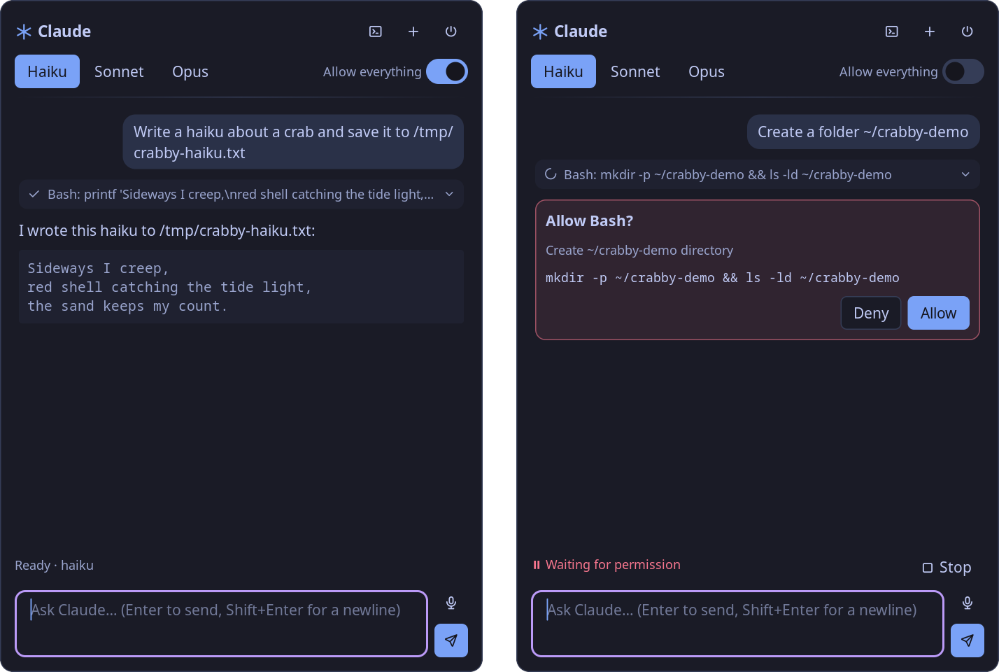
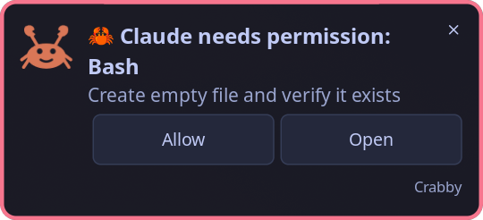
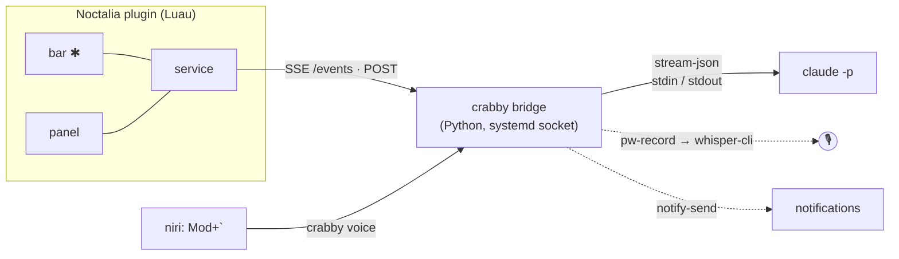

<p align="center">
  
</p>

<h1 align="center">crabby</h1>

<p align="center">
  <b>Claude Code in your Noctalia panel.</b><br>
  Ask, delegate, approve tools: right from the bar, by keyboard or by voice.
</p>

<p align="center">
  
  
  
  
  
  
  
  
  
</p>

<p align="center">
  <a href="README.ru.md">Русская версия</a>
</p>

<p align="center">
  
</p>

## Features

- **Chat with a real Claude Code agent.** It is the `claude` CLI with its tools, settings and auth, not a bare API chat. Answers stream in as markdown.
- **Tool approvals in the panel.** Every permission request becomes a card with Allow / Deny. Flip **Allow everything** at any time, even mid-turn, and pending requests are approved too.
- **Claude Code-style status line**: `✻ Thinking… (12s · ↓ 340 tok)`, the running tool, a Stop button.
- **Collapsible tool calls**: `✓ Bash: wpctl status`, click to see the output.
- **Model switch on the fly**: Haiku / Sonnet / Opus. Every new session starts on the lightest model.
- **Voice input**: `Mod+\`` records until you press it again or go quiet. [whisper.cpp](https://github.com/ggml-org/whisper.cpp) transcribes it locally on the GPU and the text is sent straight away.
- **Notifications** when the panel is closed and Claude needs a permission or has finished, with an **Allow** button right in the notification.
- **Move to terminal**: continue the same session in kitty with `claude --resume`.
- **Speaks your language.** The UI follows Noctalia's language: English, Русский, Українська, Deutsch, Français, Español, Português (BR), Italiano, Polski, Nederlands, Čeština, Türkçe, 简体中文, 日本語, 한국어. Claude answers in the language you write in.
- **Nothing runs when unused.** The bridge is socket-activated by systemd and exits when idle. `claude` lives only while a session is open and is killed after 15 idle minutes.

<table>
  <tr>
    <td></td>
    <td>
      <b>Panel closed?</b><br>
      Crabby notifies you when Claude is waiting for a permission or has finished.
      <i>Allow</i> answers the request without opening the panel.
    </td>
  </tr>
</table>

## How it works



- **`bridge/crabby.py`** owns one `claude -p --input-format stream-json --output-format stream-json` process per session. It answers `can_use_tool` control requests (`--permission-prompt-tool stdio`) and serves the panel a full view snapshot over SSE.
- **`plugin/crabby/`** is the Noctalia plugin. The service mirrors snapshots into `noctalia.state`; the bar and panel just render them. The service stays connected only while the panel is open or a session is running.

## Requirements

| | |
|---|---|
| Shell | [Noctalia](https://github.com/noctalia-dev/noctalia-shell) 5.3+ (plugin API 34), any Wayland compositor; hotkeys below are for niri |
| Agent | [Claude Code](https://docs.claude.com/en/docs/claude-code) CLI, logged in |
| Bridge | Python 3.11+, systemd user session, `notify-send` |
| Voice *(optional)* | PipeWire (`pw-record`), `whisper-cli` + a ggml model; CUDA build recommended |
| Terminal *(optional)* | kitty (configurable) |

## Install

```sh
git clone git@github.com:dvaxert/crabby.git && cd crabby
./install.sh
```

`install.sh` links `~/.local/bin/crabby`, enables `crabby-bridge.socket` and registers `plugin/` as the Noctalia plugin source `crabby-dev`.

Then:

1. Add the **`dvaxert/crabby:bar`** widget to your bar (Settings → Bar).
2. Add hotkeys, e.g. for niri:
   ```kdl
   Mod+Grave      hotkey-overlay-title="Crabby: voice" { spawn "crabby" "voice"; }
   Mod+Ctrl+Grave hotkey-overlay-title="Crabby: panel" { spawn "noctalia" "msg" "panel-toggle" "dvaxert/crabby:panel"; }
   ```
3. *(Voice)* Build whisper.cpp with CUDA and fetch a model:
   ```sh
   git clone --depth 1 https://github.com/ggml-org/whisper.cpp ~/.local/share/crabby/src/whisper.cpp
   cd ~/.local/share/crabby/src/whisper.cpp
   cmake -B build -DGGML_CUDA=ON -DCMAKE_BUILD_TYPE=Release && cmake --build build -j --target whisper-cli
   curl -L --create-dirs -o ~/.local/share/crabby/models/ggml-large-v3-turbo-q5_0.bin \
     https://huggingface.co/ggerganov/whisper.cpp/resolve/main/ggml-large-v3-turbo-q5_0.bin
   ```
   Then point `whisper_bin` at `build/bin/whisper-cli` in `~/.config/crabby/config.toml`.

## Usage

| | |
|---|---|
| Open the panel | click ✱ in the bar · `Mod+Ctrl+\`` |
| Speak | right-click ✱ · `Mod+\`` (again or pause to stop, ✕ to drop it) |
| Send | Enter (Shift+Enter for a newline) |
| New / end session | ＋ / ⏻ in the panel header |
| Continue in a terminal | ⌨ in the panel header |
| From a shell | `crabby send "find my biggest files in ~/Downloads"` |

The bar glyph shows the state: dim means no session, pulsing means working, red means a permission request or recording.

## Configuration

`~/.config/crabby/config.toml`. Every key is optional; see [`config.example.toml`](config.example.toml).

```toml
default_model = "haiku"   # every new session starts here
idle_minutes = 15         # kill claude after this much idle time
cwd = "~"                 # where claude runs
voice_language = "auto"   # or "en", "de", ... (a fixed language is faster and more accurate)
silence_sec = 1.5
```

The **Allow everything** toggle persists in `~/.local/state/crabby/state.json`.

## Development

```sh
noctalia plugins lint plugin/crabby                      # manifest and settings check
noctalia msg plugin dvaxert/crabby:service all debug     # dumps ~/.local/state/crabby/service-debug.json
journalctl --user -u crabby-bridge -f                    # bridge log
curl -s localhost:18766/state | jq                       # current view snapshot
```

`.luau` edits hot-reload; restart the bridge with `systemctl --user restart crabby-bridge`.

### Translations

Strings live in [`tools/gen_translations.py`](tools/gen_translations.py), which writes `plugin/crabby/translations/*.json` and checks every language has every key. To add a language, add a table named like Noctalia's own translation files (`pt-BR`, `zh-Hans`, …) and run `python3 tools/gen_translations.py`. The bridge has no UI strings: it sends message codes, and the plugin hands it localized notification texts.

## License

[MIT](LICENSE)
