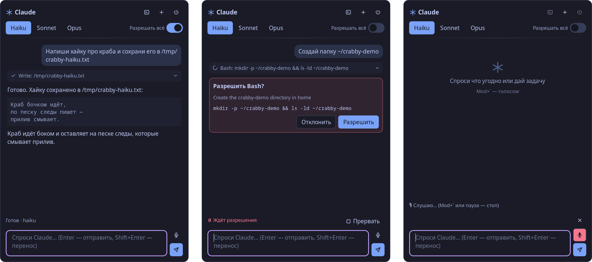
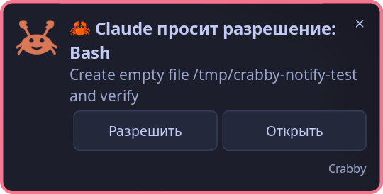
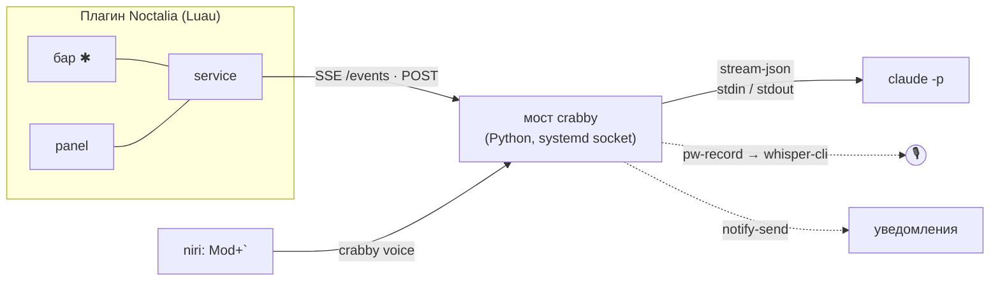

<p align="center">
  
</p>

<h1 align="center">crabby</h1>

<p align="center">
  <b>Claude Code в панели Noctalia.</b><br>
  Спрашивай, поручай задачи, разрешай инструменты прямо из бара: с клавиатуры или голосом.
</p>

<p align="center">
  
  
  
  
  
  
  
  
  
</p>

<p align="center">
  <a href="README.md">English version</a>
</p>

<p align="center">
  
</p>

## Возможности

- **Настоящий агент Claude Code**, а не голый чат с API. Это `claude` CLI со всеми инструментами, твоими настройками и авторизацией. Ответы приходят по мере генерации и показываются как markdown.
- **Разрешения прямо в панели.** Каждый запрос — карточка с кнопками «Разрешить» и «Отклонить». Переключатель «Разрешать всё» можно включить когда угодно, даже посреди ответа: висящие запросы тоже разрешатся.
- **Статусная строка как в Claude Code**: `✻ Думаю… (12с · ↓ 340 tok)`, текущий инструмент, кнопка «Прервать».
- **Вызовы инструментов свёрнуты**: `✓ Bash: wpctl status`, вывод открывается кликом.
- **Смена модели на лету**: Haiku / Sonnet / Opus. Каждая новая сессия начинается на самой лёгкой.
- **Голосовой ввод**: `Mod+\`` пишет, пока не нажмёшь ещё раз или не замолчишь. Распознаёт [whisper.cpp](https://github.com/ggml-org/whisper.cpp) локально на видеокарте, и текст сразу уходит Claude.
- **Уведомления.** Если панель закрыта, а Claude ждёт разрешения или закончил, придёт уведомление. Кнопка «Разрешить» есть прямо в нём.
- **Перенос в терминал**: та же сессия продолжается в kitty через `claude --resume`.
- **Говорит на твоём языке.** Интерфейс следует языку Noctalia: English, Русский, Українська, Deutsch, Français, Español, Português (BR), Italiano, Polski, Nederlands, Čeština, Türkçe, 简体中文, 日本語, 한국어. Claude отвечает на том языке, на котором ты пишешь.
- **Без дела ничего не крутится.** Мост запускается systemd по сокету и сам выходит, когда простаивает. `claude` живёт только пока открыта сессия и убивается после 15 минут простоя.

<table>
  <tr>
    <td></td>
    <td>
      <b>Панель закрыта?</b><br>
      Crabby пришлёт уведомление, когда Claude ждёт разрешения или закончил.
      «Разрешить» отвечает на запрос, не открывая панель.
    </td>
  </tr>
</table>

## Как устроено



- **`bridge/crabby.py`** держит на каждую сессию один процесс `claude -p --input-format stream-json --output-format stream-json`. Он отвечает на запросы разрешений `can_use_tool` (`--permission-prompt-tool stdio`) и отдаёт панели полный снапшот состояния по SSE.
- **`plugin/crabby/`** — плагин Noctalia. Сервис зеркалит снапшоты в `noctalia.state`, бар и панель их только рисуют. К мосту сервис подключён, только пока открыта панель или идёт сессия.

## Требования

| | |
|---|---|
| Шелл | [Noctalia](https://github.com/noctalia-dev/noctalia-shell) 5.3+ (plugin API 34), любой Wayland-композитор; хоткеи ниже для niri |
| Агент | [Claude Code](https://docs.claude.com/en/docs/claude-code) CLI, залогиненный |
| Мост | Python 3.11+, systemd user session, `notify-send` |
| Голос *(необязательно)* | PipeWire (`pw-record`), `whisper-cli` и ggml-модель; лучше сборка с CUDA |
| Терминал *(необязательно)* | kitty (настраивается) |

## Установка

```sh
git clone git@github.com:dvaxert/crabby.git && cd crabby
./install.sh
```

`install.sh` создаёт ссылку `~/.local/bin/crabby`, включает `crabby-bridge.socket` и добавляет `plugin/` в Noctalia как источник плагинов `crabby-dev`.

Дальше:

1. Добавь виджет **`dvaxert/crabby:bar`** в бар (Settings → Bar).
2. Добавь хоткеи, например для niri:
   ```kdl
   Mod+Grave      hotkey-overlay-title="Crabby: голосом" { spawn "crabby" "voice"; }
   Mod+Ctrl+Grave hotkey-overlay-title="Crabby: панель" { spawn "noctalia" "msg" "panel-toggle" "dvaxert/crabby:panel"; }
   ```
3. *(Голос)* Собери whisper.cpp с CUDA и скачай модель:
   ```sh
   git clone --depth 1 https://github.com/ggml-org/whisper.cpp ~/.local/share/crabby/src/whisper.cpp
   cd ~/.local/share/crabby/src/whisper.cpp
   cmake -B build -DGGML_CUDA=ON -DCMAKE_BUILD_TYPE=Release && cmake --build build -j --target whisper-cli
   curl -L --create-dirs -o ~/.local/share/crabby/models/ggml-large-v3-turbo-q5_0.bin \
     https://huggingface.co/ggerganov/whisper.cpp/resolve/main/ggml-large-v3-turbo-q5_0.bin
   ```
   Потом укажи `whisper_bin` = путь к `build/bin/whisper-cli` в `~/.config/crabby/config.toml`.

## Использование

| | |
|---|---|
| Открыть панель | клик по ✱ в баре · `Mod+Ctrl+\`` |
| Сказать голосом | ПКМ по ✱ · `Mod+\`` (повторно или пауза — стоп, ✕ — выбросить запись) |
| Отправить | Enter (Shift+Enter — перенос строки) |
| Новая / завершить сессию | ＋ / ⏻ в шапке панели |
| Продолжить в терминале | ⌨ в шапке панели |
| Из shell | `crabby send "найди самые большие файлы в ~/Downloads"` |

Глиф в баре показывает состояние: тусклый — сессии нет, пульсирует — Claude работает, красный — ждёт разрешения или идёт запись.

## Настройки

`~/.config/crabby/config.toml`. Все ключи необязательные, полный список — в [`config.example.toml`](config.example.toml).

```toml
default_model = "haiku"   # с этой модели начинается каждая сессия
idle_minutes = 15         # убить claude после стольких минут простоя
cwd = "~"                 # где запускается claude
voice_language = "ru"     # или "auto" (по умолчанию); с фиксированным языком быстрее и точнее
silence_sec = 1.5
```

Переключатель «Разрешать всё» хранится в `~/.local/state/crabby/state.json`.

## Разработка

```sh
noctalia plugins lint plugin/crabby                      # проверка манифеста и настроек
noctalia msg plugin dvaxert/crabby:service all debug     # дамп в ~/.local/state/crabby/service-debug.json
journalctl --user -u crabby-bridge -f                    # лог моста
curl -s localhost:18766/state | jq                       # текущий снапшот
```

Изменения в `.luau` подхватываются на лету. Мост перезапускается командой `systemctl --user restart crabby-bridge`.

### Переводы

Строки лежат в [`tools/gen_translations.py`](tools/gen_translations.py). Скрипт пишет `plugin/crabby/translations/*.json` и проверяет, что в каждом языке есть все ключи. Чтобы добавить язык, заведи таблицу с именем как у файлов переводов самой Noctalia (`pt-BR`, `zh-Hans`, …) и запусти `python3 tools/gen_translations.py`. В мосте нет строк интерфейса: он шлёт коды сообщений, а тексты уведомлений на нужном языке ему передаёт плагин.

## Лицензия

[MIT](LICENSE)
